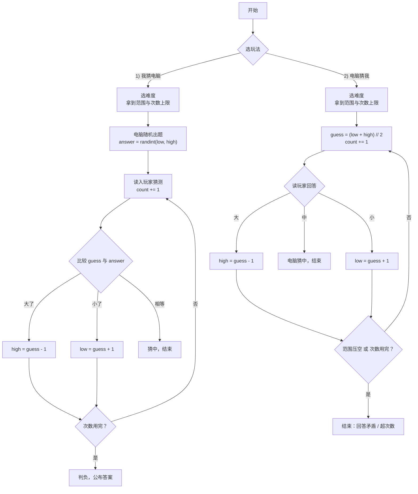

# 猜数字小游戏 Guess the Number


一个用来练习编程入门的经典小游戏：**电脑随机想一个 1~100 的整数，你来猜，程序告诉你「大了」还是「小了」，直到猜中并统计次数。**

项目提供两个版本 —— 一个能直接在浏览器里点着玩的网页版，一个在命令行里运行、代码逐行带中文注释的 Python 版。两个版本逻辑完全一致，适合对照理解「事件驱动」和「循环驱动」两种写法。

---

## 目录

- [项目简介](#项目简介)
- [功能特性](#功能特性)
- [项目结构](#项目结构)
- [环境要求](#环境要求)
- [快速开始](#快速开始)
- [玩法规则](#玩法规则)
- [程序逻辑说明](#程序逻辑说明)
- [核心代码解读](#核心代码解读)
- [获胜策略](#获胜策略)
- [版本管理：Git 与 GitHub](#版本管理git-与-github)
- [常见问题](#常见问题)
- [后续可以做的扩展](#后续可以做的扩展)
- [附录 本 README 用到的 Markdown 语法](#附录-本-readme-用到的-markdown-语法)
- [许可](#许可)

---

## 项目简介

> 这是给编程初学者准备的一个「麻雀虽小五脏俱全」的练手项目。

它没有复杂的框架和依赖，只用了 `random` 和 `math` 两个标准库，但完整包含了真实程序里最核心的几个要素：**变量、条件判断、循环、函数划分、输入校验、异常处理**。Python 文件约 340 行，其中相当一部分是注释，从上往下读一遍就能理解全部逻辑。

难度、次数上限、两种玩法都是后加的，但代码没有变乱 —— 靠的是把「读输入」「算上限」「打印结果」这些杂活拆成独立的小函数，主流程只剩下「选玩法 → 玩一局 → 要不要再来」三句话。这种「先让主流程读起来像人话」的写法，比堆功能本身更值得学。

**适合谁看？**

- 刚学完 `if` / `while` / 函数，想找个完整例子练手的人
- 想搞清楚「一个程序是怎么组织成多个函数的」的人
- 需要一份可直接交给别人运行的作业 / 演示项目的人

---

## 功能特性

- [x] **两种玩法**：你猜电脑，或者你心里想数字、看电脑怎么猜
- [x] **三档难度**：简单 1~50 / 普通 1~100 / 困难 1~1000
- [x] **次数上限**：按难度自动算出（7 / 8 / 11 次），用完即判负
- [x] 每次猜测给出「大了 ↓」/「小了 ↑」提示，并实时显示已猜次数与可能范围
- [x] **输入校验**：输入 `abc`、`0`、`999` 都会友好提示，且不浪费次数
- [x] 彩蛋：根据提示动态收窄「可能范围」，直观展示二分查找
- [x] 反向玩法会识别「回答前后矛盾」（比如一直说「大了」）并提示你
- [x] 支持随时输入 `q` 退出，一局结束可直接再来
- [x] 捕获 `Ctrl + C` 与输入流断开，不会甩出一屏红色报错
- [x] 网页版零安装，双击即玩；命令行版零依赖，一个文件跑到底

---

## 项目结构

```text
2026-10-16-22-16-10/
├── guess_number.py      # 命令行版（Python，逻辑最清晰，建议先看这个）
├── guess-number.html    # 网页版（HTML + CSS + JS 全在一个文件里）
├── README.md            # 项目说明文档（本文件）
├── .gitignore           # 告诉 Git 哪些文件不用纳入版本管理
├── .gitattributes       # 统一换行符，避免跨平台时整个文件被标记为已修改
└── .workbuddy/          # 工具自动生成的目录，与游戏无关，已被 .gitignore 排除
```

| 文件 | 技术栈 | 运行方式 | 特点 |
| :--- | :--- | :--- | :--- |
| `guess_number.py` | Python 3 | 命令行 `python guess_number.py` | 注释详尽，适合学习逻辑 |
| `guess-number.html` | HTML / CSS / JavaScript | 双击用浏览器打开 | 界面美观，适合快速试玩 |
| `README.md` | Markdown | 用支持 Markdown 的编辑器预览 | 项目说明书，即本文件 |

---

## 环境要求

| 项目 | 要求 |
| :--- | :--- |
| 操作系统 | Windows / macOS / Linux 均可（本文档以 Windows 为例） |
| Python 版本 | **3.6 或更高**（用到了 f-string 格式化） |
| 第三方库 | **无**，只用标准库 `random` 和 `math` |
| 浏览器（网页版） | Chrome / Edge / Firefox 等现代浏览器 |

> [!NOTE]
> 不需要执行 `pip install`，因为程序没有依赖任何第三方包。这一点也是特意设计的 —— 让你把注意力放在逻辑本身，而不是环境配置上。

---

## 快速开始

### 方式一：网页版（最简单）

1. 找到 `guess-number.html` 文件
2. 双击它，或者右键选择「打开方式 → 浏览器」
3. 先选玩法（我猜电脑 / 电脑猜我）和难度，点「开始游戏」
4. 玩法一：输入数字后点「猜」（也可以直接按回车）；玩法二：点「大了 / 小了 / 中了」回答电脑

### 方式二：命令行版（本项目的重点）

按下面三步操作即可，每一步都请照抄命令：

**第 1 步：打开命令提示符**

按 `Win + R` 键，在弹出的输入框里输入 `cmd`，然后按回车。

**第 2 步：切换到项目文件夹**

```bash
cd /d C:\Users\Maryn\WorkBuddy\2026-10-16-22-16-10
```

敲完回车。没有报错就说明切换成功了，可以再敲一个 `dir` 确认能看到 `guess_number.py`。

> [!WARNING]
> 这里必须用 `cd /d` 而不是普通的 `cd`。`/d` 的作用是允许同时切换盘符（比如从 C 盘切到 D 盘），少写它会提示「系统找不到指定的路径」。
> 如果路径里有空格，记得用英文双引号把整个路径包起来。

**第 3 步：运行程序**

```bash
python guess_number.py
```

然后就可以开始猜了。

> [!TIP]
> 如果提示 `'python' 不是内部或外部命令`，说明 Python 没有加入系统环境变量，换成 `py guess_number.py` 通常就能运行。还不行的话，用 `python --version` 检查一下 Python 是否安装成功。

### 运行效果

```text
==================================
  猜 数 字 小 游 戏
==================================
两种玩法随便挑，任何时候输入 q 都能退出。

==================================
  1) 我猜电脑 —— 电脑出题，你来猜
  2) 电脑猜我 —— 你想数字，电脑来猜
  q) 退出
==================================
请选择玩法（1 / 2）：1

请选择难度：
  1) 简单   1 ~ 50   最多 7 次机会
  2) 普通   1 ~ 100   最多 8 次机会
  3) 困难   1 ~ 1000   最多 11 次机会
请输入 1 / 2 / 3：2

==================================
  我猜电脑 · 普通
==================================
我心里想了一个 1 ~ 100 的整数。
你最多可以猜 8 次，随时输入 q 可以退出。

请猜一个 1 ~ 100 的数字：50
  → 大了 ↓   再猜小一点
  已猜 1/8 次   可能范围：1 ~ 49

请猜一个 1 ~ 100 的数字：25
  → 小了 ↑   再猜大一点
  已猜 2/8 次   可能范围：26 ~ 49

请猜一个 1 ~ 100 的数字：37
  → 小了 ↑   再猜大一点
  已猜 3/8 次   可能范围：38 ~ 49

请猜一个 1 ~ 100 的数字：42

==================================
  猜中啦！答案就是 42
  你一共猜了 4 次（上限 8 次）
  这已经是很漂亮的成绩了 👍
==================================
再来一局？（直接回车 = 再来，输入 n = 结束）：
```

反向玩法长这样 —— 你心里想一个数，电脑猜，你只回答「大 / 小 / 中」：

```text
==================================
  电脑猜我 · 普通
==================================
请在心里想一个 1 ~ 100 的整数，不要告诉我。
我每猜一个，你就回答：
  大 = 我猜大了（答案更小）
  小 = 我猜小了（答案更大）
  中 = 我猜对了

想好了就按回车开始（输入 q 退出）：

  第 1/8 次，我猜：50
  你回答（大 / 小 / 中，q 退出）：大
     那答案就在 1 ~ 49 之间，我还剩 7 次机会

  第 2/8 次，我猜：25
  你回答（大 / 小 / 中，q 退出）：小
     那答案就在 26 ~ 49 之间，我还剩 6 次机会

  ……（中间省略 4 次）

  第 7/8 次，我猜：42
  你回答（大 / 小 / 中，q 退出）：中
==================================
  猜对啦！你心里想的是 42
  我只用了 7 次
  这已经是很漂亮的成绩了 👍
==================================
```

---

## 玩法规则

### 通用规则

1. 开局先选**玩法**，再选**难度**，难度决定了数字范围和本局次数上限：

   | 难度 | 数字范围 | 次数上限 |
   | :--- | :--- | :--- |
   | 简单 | 1 ~ 50 | 7 次 |
   | 普通 | 1 ~ 100 | 8 次 |
   | 困难 | 1 ~ 1000 | 11 次 |

2. 每猜一次「次数」加 1；输入不合法的内容**不计入次数**
3. 次数用完还没猜中，本局判负并公布答案
4. 一局结束后可以选择再来；游戏中随时输入 `q` / `quit` / `exit` / `退出` 可以退出

### 玩法一：我猜电脑

1. 电脑随机生成范围内的一个整数作为答案
2. 你输入一个数字，程序给出三种反馈之一：
   - 猜的数字**比答案大** → 显示 `大了`
   - 猜的数字**比答案小** → 显示 `小了`
   - 猜的数字**等于答案** → 显示答案和总次数，本局结束

### 玩法二：电脑猜我

1. 你在心里想一个范围内的整数（不要输入到程序里，程序真的不知道）
2. 电脑每次猜一个数，你回答：
   - `大` —— 它猜大了，答案更小
   - `小` —— 它猜小了，答案更大
   - `中` —— 它猜对了
3. 电脑用的是**二分法**：每次都猜当前范围的中点，所以范围会迅速对半收缩
4. 如果你一直回答「大」这种前后矛盾的答案，范围会被压空，程序会提示你「回答矛盾了」

---

## 程序逻辑说明

两种玩法本质上都是「**猜 → 比较 → 收窄范围 → 再猜**」的循环，区别只在于每一轮是谁在出数字：



用文字描述就是这几步：

| 步骤 | 做什么 | 对应代码 |
| :--: | :--- | :--- |
| 1 | 选玩法、选难度，算出次数上限 | `choose_mode()` / `choose_level()` / `max_attempts()` |
| 2 | 玩法一：随机生成答案 | `random.randint(low, high)` |
| 3 | 玩法一：读入玩家输入并校验 | `read_guess()` 里 `input()` + `try / except` |
| 4 | 玩法一：比较大小并收窄范围 | `if / elif / else` + `min / max` |
| 5 | 玩法二：电脑取中点猜，按回答收窄范围 | `(low + high) // 2` |
| 6 | 判定结束：猜中 / 超次数 / 回答矛盾 | `print_result()` |

---

## 核心代码解读

程序一共 9 个函数，但可以分成三层来读：**工具层 → 玩法层 → 调度层**。

| 层次 | 函数 | 职责 |
| :--- | :--- | :--- |
| 工具 | `hr()` / `banner()` | 打印分隔线与标题，纯输出，与逻辑无关 |
| 工具 | `max_attempts(low, high)` | 算出这个范围的次数上限 |
| 工具 | `read_guess(low, high)` | 读玩家输入 + 校验，**最值得学习的一个函数** |
| 工具 | `read_feedback()` | 电脑猜你时，读「大 / 小 / 中」 |
| 工具 | `choose_mode()` / `choose_level()` | 两个菜单，返回玩家选的玩法与难度 |
| 玩法 | `play_player_guesses()` | 玩法一的主循环 |
| 玩法 | `play_computer_guesses()` | 玩法二的二分法循环 |
| 调度 | `print_result()` | 把一局结果打印成框 |
| 调度 | `main()` | 开场白 + 控制「要不要再来一局」 |

**① 常量集中放在文件顶部**，想改规则只改这里：

```python
LEVELS = {
    1: ("简单", 1, 50),      # 编号 -> (名字, 最小值, 最大值)
    2: ("普通", 1, 100),
    3: ("困难", 1, 1000),
}
EXIT_WORDS = {"q", "quit", "exit", "退出"}
```

把难度写成「字典 + 元组」，好处是将来新增一档难度**只要加一行**，`choose_level()` 会自动把它列进菜单。

**② `max_attempts()` —— 一行数学算出次数上限**

```python
def max_attempts(low, high):
    total = high - low + 1
    return math.ceil(math.log2(total)) + 1
```

`log2(100) ≈ 6.64`，向上取整是 7 —— 这正好是二分法的最坏次数。末尾 `+1` 是留给玩家的余量。

**③ `read_guess()` —— 用一个元组表达三种结果**

这是本程序最巧妙的地方：输入可能存在三种情况，函数用元组的第一个元素把状态传出去，调用方用 `if` 区分处理，逻辑非常清晰。

```python
def read_guess(low, high):
    text = input(f"请猜一个 {low} ~ {high} 的数字：").strip()

    if text.lower() in EXIT_WORDS:          # 情况一：玩家想退出
        return "exit", None
    try:
        guess = int(text)                   # 情况二：输入了 abc 这类内容
    except ValueError:
        print("  输入有误：只能输入整数，请重新输入\n")
        return "error", None
    if guess < low or guess > high:         # 情况三：数字超出范围
        print(f"  输入有误：请输入 {low} ~ {high} 之间的数字\n")
        return "error", None
    return "ok", guess                      # 一切正常
```

> [!IMPORTANT]
> 校验失败时 `count` **不会**加 1。这一点很重要 —— 否则玩家乱按键盘就能把次数刷上去，统计就失去意义了。

**④ `play_player_guesses()` —— 玩法一的主循环**

```python
while count < limit:                    # 次数用完就跳出，判负
    status, guess = read_guess(low, high)

    if status == "exit":
        return "exit", count, answer
    if status == "error":
        continue                        # 输入不合法，不计次数

    count += 1

    if guess > answer:
        win_high = min(win_high, guess - 1)     # 答案肯定比 guess 小
        print("  → 大了 ↓   再猜小一点")
    elif guess < answer:
        win_low = max(win_low, guess + 1)       # 答案肯定比 guess 大
        print("  → 小了 ↑   再猜大一点")
    else:
        return "win", count, answer             # 猜中了
```

注意循环条件已经不是 `while True`，而是 `while count < limit` —— **次数上限就是靠这一行实现的**，不需要额外写 break。

**⑤ `play_computer_guesses()` —— 玩法二，二分法只要三行**

```python
while count < limit and guess_low <= guess_high:
    guess = (guess_low + guess_high) // 2    # 取中点

    feedback = read_feedback()
    if feedback == "big":
        guess_high = guess - 1               # 猜大了，答案更小
    elif feedback == "small":
        guess_low = guess + 1                # 猜小了，答案更大
    else:
        return "win", count, guess
```

`//` 是整数除法，保证中点仍然是整数。循环条件里的 `guess_low <= guess_high` 顺带就是「作弊检测」：范围一旦被压空，说明玩家的回答自相矛盾。

**⑥ 两个玩法返回值格式统一**

```python
return "win", count, answer      # (结果, 猜了几次, 答案)
```

所以 `main()` 里不管哪种玩法，后续处理都只需要写一份：

```python
if mode == "player":
    result, count, answer = play_player_guesses(level_name, low, high)
else:
    result, count, answer = play_computer_guesses(level_name, low, high)

print_result(result, count, answer, limit, mode == "player")
```

**⑦ `main()` 里的异常兜底**，让你按 `Ctrl + C` 时看到的是中文提示而不是报错：

```python
except (KeyboardInterrupt, EOFError):
    print("\n\n已退出，下次再来玩～")
```

**⑧ 固定入口写法**，保证只有直接运行本文件时才会开始游戏：

```python
if __name__ == "__main__":
    main()
```

---

## 获胜策略

别看这游戏简单，**有最优解**。

因为每次提示都在排除一半的可能性，所以每次猜「当前范围的中间值」，范围就会对半收缩：100 → 50 → 25 → 13 → 7 → 4 → 2 → 1。

计算方式是：

$$\text{最坏次数} = \lceil \log_2 100 \rceil = 7$$

也就是说，**1~100 最多 7 次必定猜中**。三档难度对应的理论值如下，程序给的上限都在理论值上多留了 1 次：

| 难度 | 范围 | 元素个数 | 理论最坏次数 | 程序给的上限 |
| :--- | :--- | :---: | :---: | :---: |
| 简单 | 1 ~ 50 | 50 | 6 | 7 |
| 普通 | 1 ~ 100 | 100 | 7 | 8 |
| 困难 | 1 ~ 1000 | 1000 | 10 | 11 |

程序里那个「可能范围」就是为此准备的 —— 观察它的变化，你就知道每一步是否走在最优路径上。如果能在理论上限之内（也就是 `上限 - 1` 次）猜中，程序还会额外夸你一句。

> [!TIP]
> 试试第一手直接猜中点（比如 1~100 猜 50 或 51），然后每步都取范围中点，你会发现 7 次之内一定命中。这就是**二分查找**算法的日常版本。
>
> 想亲眼看看它有多快？去玩「电脑猜我」，选困难（1~1000），随便想一个数。无论你想哪个，它**最多 10 次**就能猜到 —— 这就是算法和瞎猜的差距。

---

## 版本管理：Git 与 GitHub

本项目已经是一个完整的 Git 仓库，并托管在 GitHub 上：

**https://github.com/Maryn0128/guess-number**

### 想下载下来看 / 发给别人

| 方式 | 操作 | 适合场景 |
| :--- | :--- | :--- |
| **Download ZIP**（最简单） | 打开上面的仓库页面 → 绿色 `Code` 按钮 → `Download ZIP` → 解压 | 只是想拿到文件、不需要版本管理 |
| **git clone**（推荐） | `git clone git@github.com:Maryn0128/guess-number.git` | 想以后能 `git pull` 更新、能提交自己的改动 |
| **直接复制本地文件** | 文件就在本机 `C:\Users\Maryn\WorkBuddy\2026-10-16-22-16-10` | 只是想在本机跑一下 |

> [!NOTE]
> `clone` / `push` 用的是 SSH 地址（`git@github.com:...`）而不是 HTTPS。原因是本项目所在网络环境下 `github.com` 的 HTTPS 经常超时，而 SSH 走 443 端口是通的 —— 具体原因见下面的「踩坑记录」。

### 日常更新，只要三条命令

```bash
git add -A                          # 把改动加入暂存区
git commit -m "改了什么"             # 生成一次提交（快照）
git push                            # 推到 GitHub
```

第一次推送时用过 `-u origin main`，它把本地 `main` 和远程 `origin/main` 绑定了起来，之后就可以直接写 `git push`。

### 常用查看命令

| 命令 | 作用 |
| :--- | :--- |
| `git status` | 看当前有哪些文件被改了、哪些已暂存 |
| `git log --oneline` | 一行一条地看提交历史 |
| `git diff` | 看具体改了哪几行 |
| `git pull` | 把 GitHub 上的新改动拉到本地 |

### 本次搭建仓库时踩到的两个坑（值得记一下）

**坑一：`github.com` 打不开，但其实是代理的问题**

一开始用 `curl https://github.com` 全部超时，看起来像被墙。但绕过代理直连（`curl --noproxy '*'`）后，`github.com/new` 只用了 0.7 秒就返回 HTTP 302 —— 真正的问题在中间那层代理返回了 `502`，而不是网络封锁。

> 教训：遇到「网站打不开」，先用 `curl -s -o /dev/null -w "HTTP %{http_code} %{time_total}s" 网址` 测具体状态码和耗时，再判断是 DNS、代理还是真的不通，比反复刷新浏览器有效得多。

**坑二：22 端口和主站被拦时，用 SSH over 443 绕过去**

当 `github.com:443` 和常规的 22 端口都不稳定时，GitHub 官方提供了一个备用通道 `ssh.github.com:443`。配置写进 `~/.ssh/config` 后，`git push` 命令一个字都不用改：

```text
Host github.com
    HostName ssh.github.com
    Port 443
    User git
```

验证方式：`ssh -T git@github.com`。如果返回 `Hi 用户名! You've successfully authenticated`，说明公钥已登记且通道打通；返回 `Permission denied (publickey)` 则说明连上了但公钥还没加，去 https://github.com/settings/keys 添加即可。

### 还有一个容易忽略的点：提交署名

Git 的提交里带作者信息，如果和 GitHub 账号不匹配，提交在仓库里不会算成你的贡献。所以要先确认：

```bash
git config user.name "你的用户名"
git config user.email "你的邮箱"
```

如果之前的提交署名写错了，可以就地修正（只在还没推送时安全）：

```bash
git commit --amend --reset-author --no-edit
```

---

## 常见问题

| 现象 | 原因 | 解决办法 |
| :--- | :--- | :--- |
| `'python' 不是内部或外部命令` | Python 未加入环境变量 | 改用 `py guess_number.py`，或重新安装 Python 并勾选 Add to PATH |
| `cd` 提示「系统找不到指定的路径」 | 漏了 `/d`，或路径写错 | 用 `cd /d 完整路径`，右键文件夹可复制完整路径 |
| 中文显示成乱码 | 控制台编码不是 UTF-8 | 先执行 `chcp 65001` 再运行程序 |
| 输入回车后没反应 | 需要先输入内容再回车 | 输入数字（如 `50`）后按回车 |
| 按 Ctrl + C 想退出 | 已做异常捕获 | 会正常显示「已退出，下次再来玩～」 |
| 觉得某个难度太难 / 太简单 | 难度和范围写在常量里 | 改文件顶部的 `LEVELS`，比如把简单改成 `(1, 1, 30)`，或直接新增一档 `4: ("地狱", 1, 10000)` |
| 觉得次数上限太紧 | 上限 = 理论值 + 1 | 改 `max_attempts()` 里末尾的 `+ 1`，比如改成 `+ 3` 就宽松很多 |
| 想调试，怎么看到答案 | 答案本来就不该显示给玩家 | 命令行版：临时在 `play_player_guesses()` 里加一行 `print(answer)`；网页版：取消 JS 中 `// console.log('答案是：', answer)` 的注释 |
| 想把项目发给别人 / 换台电脑 | 文件只在本机 | 仓库已托管在 GitHub，让对方 `git clone` 或直接下载 ZIP，见「版本管理」一节 |

---

## 后续可以做的扩展

- [x] ~~增加**难度选择**：开局让玩家选简单（1~50）/ 普通（1~100）/ 困难（1~1000）~~ ✅ 已完成
- [x] ~~增加**次数上限**：比如最多猜 7 次，超了就算输~~ ✅ 已完成
- [x] ~~反过来玩：**玩家出题、电脑来猜**（电脑用二分法）~~ ✅ 已完成
- [ ] 增加**计分与排行榜**：把每局成绩存到文件里，记录最高分
- [ ] 增加**计时功能**，统计每局耗时
- [ ] 把网页版和命令行版的共用逻辑抽出来，做成一个小模块
- [ ] 加一个「复盘」功能：一局结束后，把每一步的方向和中点画出来，直观对比「你走的路线」和「最优路线」

---

## 附录 本 README 用到的 Markdown 语法

如果你也在学 Markdown，可以对照这份文件看每种语法的实际效果：

| 语法 | 写法 | 用途 |
| :--- | :--- | :--- |
| 一级 / 二级标题 | `# 标题` / `## 标题` | 划分文档层级 |
| 加粗 / 斜体 | `**粗体**` / `*斜体*` | 强调关键词 |
| 行内代码 | `` `count += 1` `` | 标记变量名、函数名、短命令 |
| 代码块 | 三个反引号 + 语言名 | 展示可复制运行的代码，带语法高亮 |
| 无序 / 有序列表 | `-` / `1.` | 罗列要点与步骤 |
| 任务列表 | `- [x]` / `- [ ]` | 表示已完成 / 待办，常用于需求清单 |
| 表格 | `\| 列 \| 列 \|` | 结构化对比信息 |
| 引用块 | `> 文字` | 引用说明或提示 |
| 提示框 | `> [!NOTE]` 等 | GitHub 上会渲染成彩色提示框 |
| 链接 | `[文字](网址)` | 跳转到其他页面 |
| 图片 / 徽章 | `` | 显示图片，shields.io 可生成状态徽章 |
| 分隔线 | `---` | 分隔章节 |
| 流程图 | 三个反引号 + `mermaid` | 在文档里直接画流程图 |

**怎么预览 Markdown 的排版效果？**

- **VS Code**：打开 `.md` 文件后按 `Ctrl + Shift + V`，右侧即可看到渲染效果
- **Typora / Obsidian**：所见即所得的 Markdown 编辑器，输入时就能看到排版
- **GitHub / GitLab**：把文件推送到仓库后，README 会自动渲染在仓库首页
- **腾讯文档 / 语雀**：也支持直接导入 Markdown 文件

---

## 许可

这是一个用于学习和练习的项目，你可以自由复制、修改、用于教学或个人练习，无需署名。

---

<p align="right">Made with Python 3 · 2026-10-16</p>
